# CloudForge — Cloud-Native DevSecOps Platform

A production-oriented DevSecOps portfolio project demonstrating containerized application development, automated CI/CD, security scanning, infrastructure monitoring, and cloud deployment architecture.

**Project:** CloudForge
**Repository:** [cloud-native-devsecops-platform](https://github.com/rajavarma21/cloud-native-devsecops-platform)
**Status:** Local application, Jenkins CI pipeline, Prometheus integration and Grafana provisioning implemented. AWS deployment is planned.

---

## Table of Contents

1. [Project Overview](#project-overview)
2. [Architecture](#architecture)
3. [Technology Stack](#technology-stack)
4. [Key Features](#key-features)
5. [Screenshots and Evidence](#screenshots-and-evidence)
6. [Prerequisites](#prerequisites)
7. [Local Setup](#local-setup)
8. [Application Endpoints](#application-endpoints)
9. [Monitoring and Observability](#monitoring-and-observability)
10. [CI/CD Pipeline](#cicd-pipeline)
11. [DevSecOps and Security](#devsecops-and-security)
12. [Repository Structure](#repository-structure)
13. [Troubleshooting](#troubleshooting)
14. [Future Enhancements](#future-enhancements)
15. [Skills Demonstrated](#skills-demonstrated)

---

## Project Overview

CloudForge is a cloud-native DevSecOps platform designed to demonstrate how modern applications can be developed, containerized, tested, secured, monitored and prepared for cloud deployment.

The application consists of:

- React frontend for the application dashboard.
- Node.js and Express backend API.
- Redis for application data and counter management.
- Docker and Docker Compose for container orchestration.
- Jenkins for continuous integration.
- npm audit for dependency vulnerability analysis.
- Trivy for container image security scanning.
- Prometheus for metrics collection.
- Grafana for monitoring dashboards.

The project follows DevSecOps principles by incorporating automated testing, security validation and observability into the application lifecycle.

**Current implementation:** Local Docker-based application and monitoring stack, with Jenkins CI and security scanning.

**Future implementation:** AWS infrastructure using Terraform, Amazon ECR, ECS Fargate, IAM and CloudWatch.

---

## Architecture

### Application and monitoring architecture

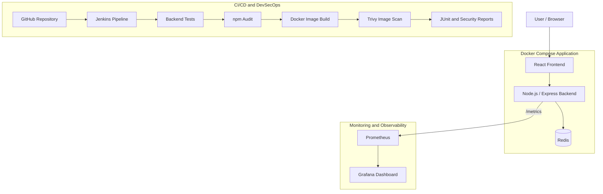

### Application flow

1. Users access the React frontend.
2. The frontend communicates with the Express backend.
3. The backend uses Redis for counter operations.
4. Backend health and readiness endpoints provide service checks.
5. Prometheus scrapes backend metrics through `/metrics`.
6. Grafana uses Prometheus as its metrics datasource.

### CI/CD flow

1. Developer pushes source code to GitHub.
2. Jenkins checks out the repository.
3. Docker Compose configuration is validated.
4. Backend tests execute.
5. npm audit checks dependencies.
6. Docker images are built.
7. Trivy scans container images.
8. JUnit and Trivy reports are published or archived.

---

## Technology Stack

| Category | Technology |
|---|---|
| Frontend | React, Vite |
| Backend | Node.js, Express |
| Database / Cache | Redis |
| Containerization | Docker |
| Container orchestration | Docker Compose |
| CI/CD | Jenkins |
| Source control | Git, GitHub |
| Dependency security | npm audit |
| Container security | Trivy |
| Metrics collection | Prometheus |
| Monitoring dashboards | Grafana |
| Infrastructure as Code | Terraform — planned |
| Cloud platform | AWS — planned |

---

## Key Features

### Application

- Containerized React frontend.
- Node.js and Express REST API.
- Redis-backed counter functionality.
- Backend health endpoint.
- Backend readiness endpoint with Redis connectivity validation.
- HTTP security headers through Helmet.
- Restricted frontend-origin CORS configuration.
- Non-root container runtime for the backend.

### CI/CD

- Jenkins automated pipeline.
- Docker Compose validation.
- Automated backend tests.
- npm dependency auditing.
- Frontend and backend Docker image builds.
- Trivy security scanning.
- JUnit test result publishing.
- Build artifact archiving.

### Monitoring

- Prometheus backend metrics endpoint.
- Default Node.js runtime metrics.
- HTTP request counter.
- HTTP request duration histogram.
- Prometheus scraping every 15 seconds.
- Grafana Prometheus datasource provisioning.
- Grafana dashboard provisioning.
- Persistent monitoring data volumes.

---

## Screenshots and Evidence

Screenshots are included as practical evidence of the implementation. Each image should represent an actual result from the running project.

### Application and infrastructure

| Screenshot | Evidence |
|---|---|
| 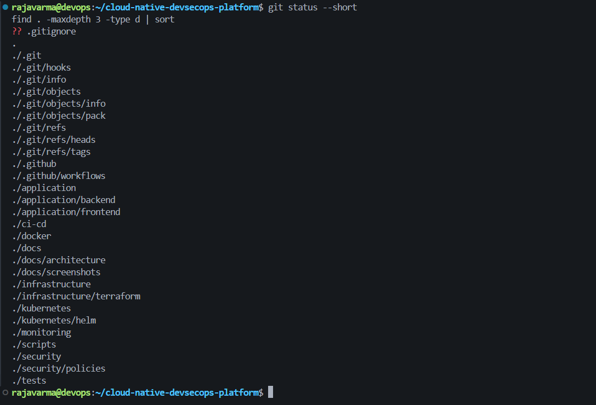 | Repository structure |
| 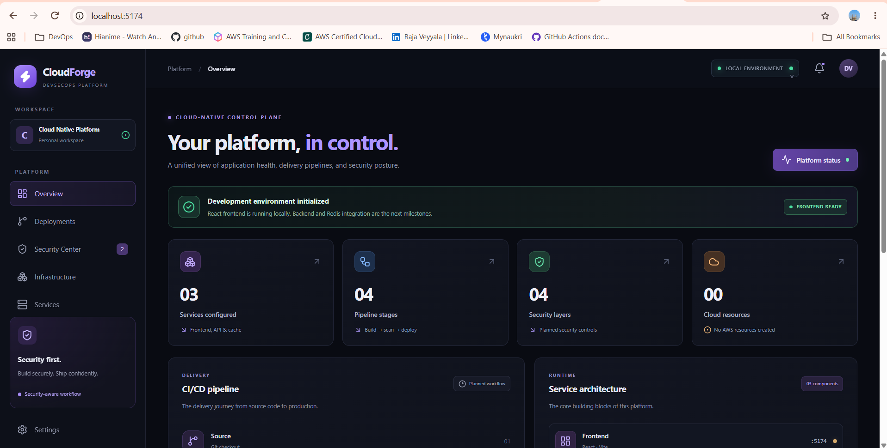 | Application dashboard |
| 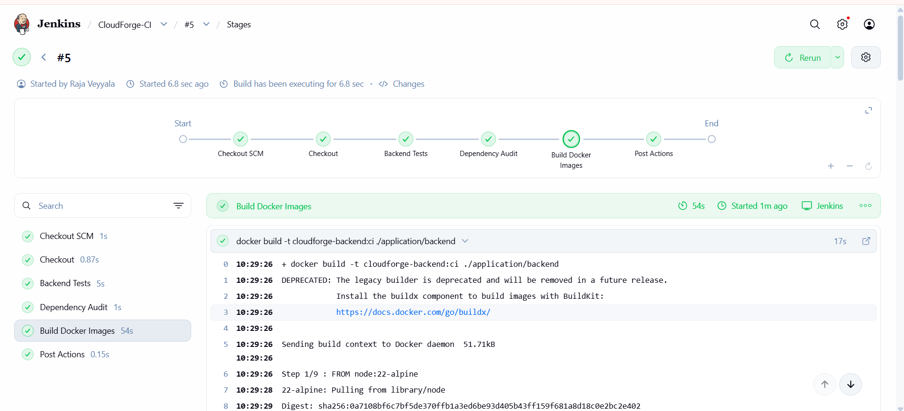 | Successful Jenkins pipeline |
| 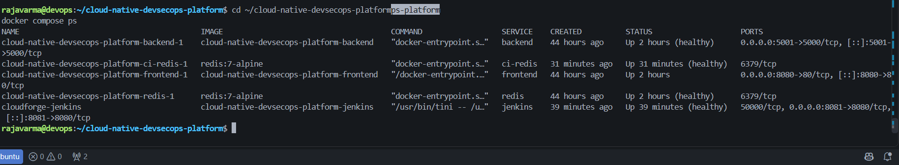 | Running Docker containers |
| 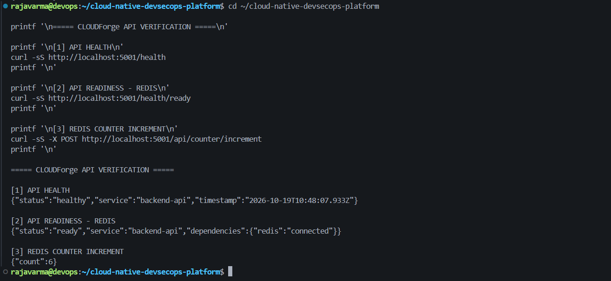 | Backend health verification |

### DevSecOps and vulnerability scanning

| Screenshot | Evidence |
|---|---|
| 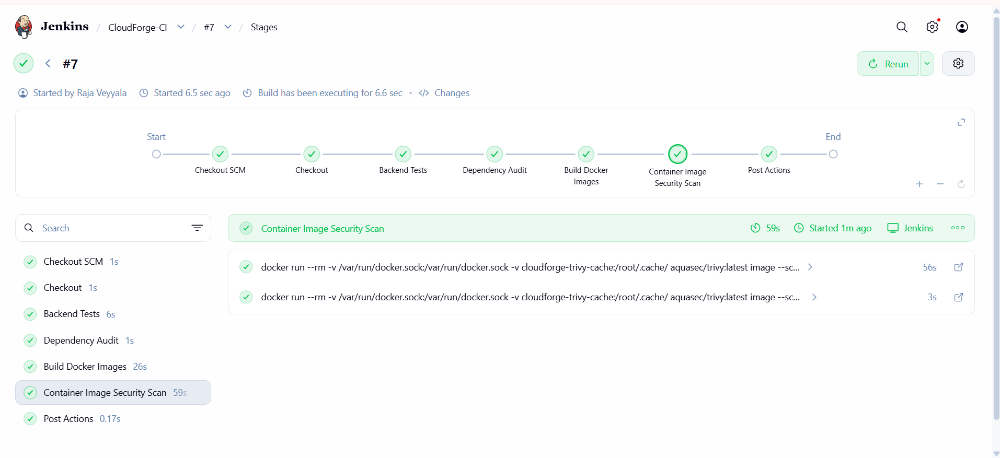 | Trivy pipeline stage |
| 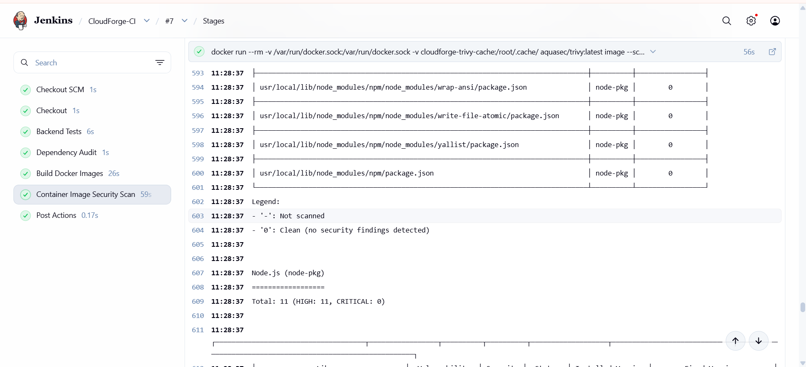 | Backend image scan |
| 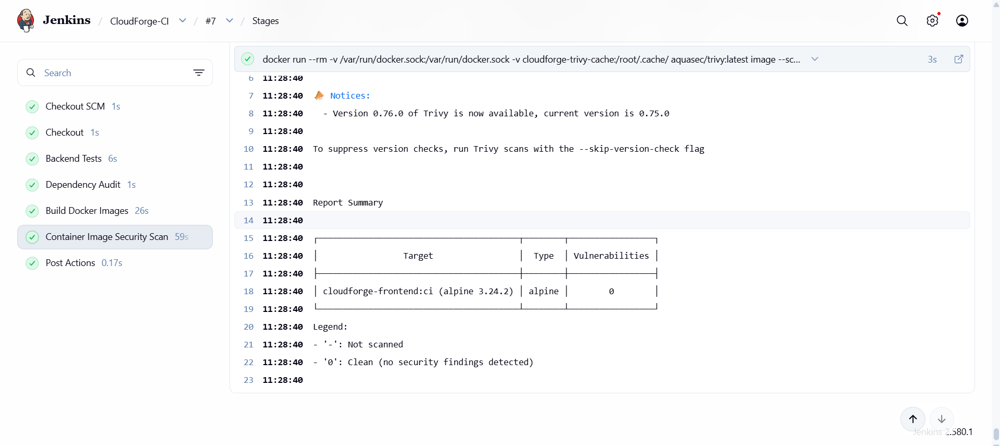 | Frontend image scan |

### CI/CD reports and test evidence

| Screenshot | Evidence |
|---|---|
| 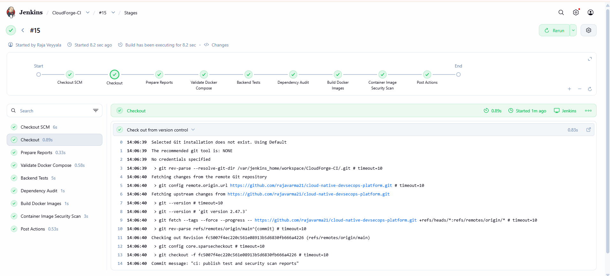 | Pipeline report generation |
| 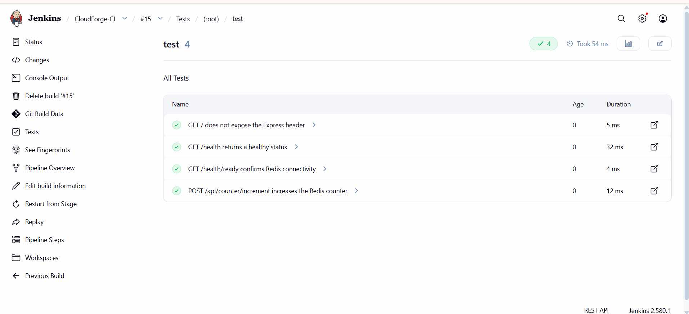 | Backend test results |
| 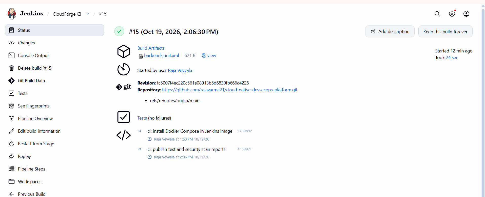 | Archived CI artifacts |

### Monitoring and Observability Evidence

The following screenshots demonstrate the successfully implemented Prometheus and Grafana monitoring stack.

| Screenshot | Description |
|---|---|
| 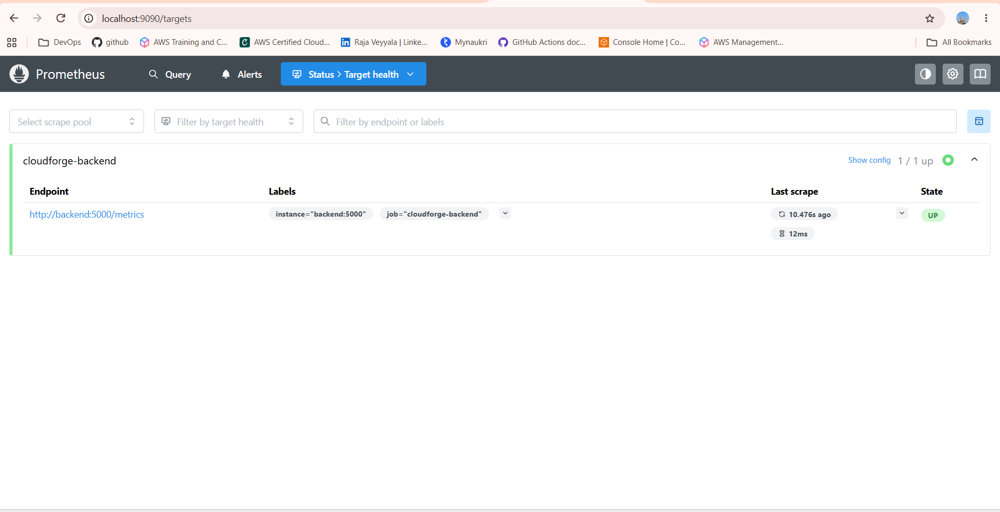 | Prometheus backend target successfully reporting UP |
| 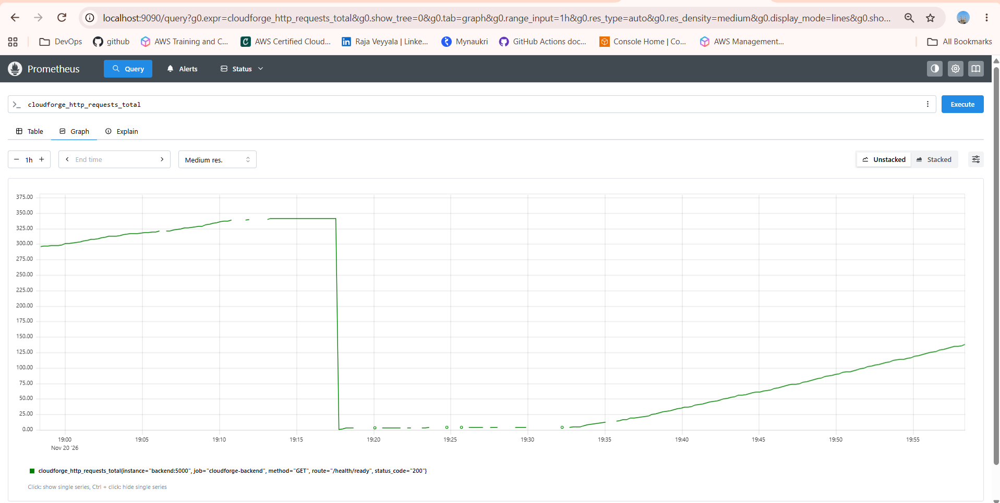 | CloudForge HTTP request metrics collected by Prometheus |
| 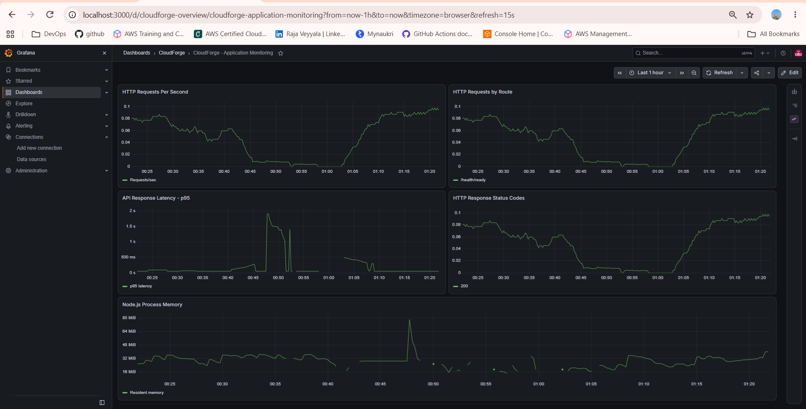 | Grafana application monitoring dashboard with HTTP and latency metrics |
| 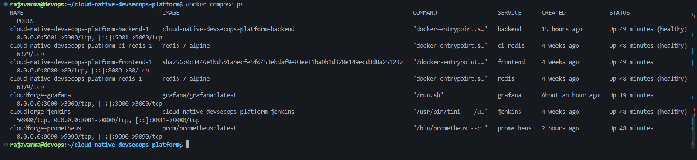 | Running application, CI, and monitoring containers |


## Prerequisites

Install the following tools:

- Git
- Docker Engine
- Docker Compose plugin
- Node.js and npm (for running backend tests locally)
- A web browser

The commands below assume Linux or WSL.

---

## Local Setup

### 1. Clone the repository

```bash
git clone https://github.com/rajavarma21/cloud-native-devsecops-platform.git

cd cloud-native-devsecops-platform
```

### 2. Configure environment variables

Create your local environment file:

```bash
cp .env.example .env
vim .env
```

Configure a strong local Grafana password:

```dotenv
GRAFANA_ADMIN_USER=admin
GRAFANA_ADMIN_PASSWORD=replace-with-a-strong-password
```

The `.env` file is excluded from Git. Never commit actual credentials.

### 3. Validate Docker Compose

```bash
docker compose config --quiet
```

### 4. Start the application and monitoring stack

```bash
docker compose up -d --build
```

Check the services:

```bash
docker compose ps
```

### 5. Access the application

| Service | URL |
|---|---|
| Frontend | http://localhost:8080 |
| Backend API | http://localhost:5001 |
| Prometheus | http://localhost:9090 |
| Grafana | http://localhost:3000 |

Grafana login credentials are configured in the local `.env` file.

### 6. Verify backend health

```bash
curl -i http://localhost:5001/health

curl -i http://localhost:5001/health/ready
```

### 7. Verify Redis counter

```bash
curl -X POST http://localhost:5001/api/counter/increment
```

Repeat the request to verify that the counter increments.

### 8. Verify Prometheus

```bash
curl http://localhost:9090/-/healthy
```

Check the Prometheus targets:

```bash
curl -s 'http://localhost:9090/api/v1/targets'
```

The `cloudforge-backend` target should report `up`.

### 9. Verify Grafana

```bash
curl http://localhost:3000/api/health
```

Expected response includes:

```json
{
  "database": "ok"
}
```

---

## Application Endpoints

| Method | Endpoint | Purpose |
|---|---|---|
| GET | `/` | Backend service information |
| GET | `/health` | Application health check |
| GET | `/health/ready` | Readiness and Redis dependency check |
| POST | `/api/counter/increment` | Increment Redis counter |
| GET | `/metrics` | Prometheus metrics endpoint |

The `/metrics` endpoint exposes application and Node.js runtime metrics for Prometheus collection.

---

## Monitoring and Observability

### Prometheus

Prometheus collects backend metrics using the configuration:

`monitoring/prometheus/prometheus.yml`

The backend target is:

```yaml
scrape_configs:
  - job_name: "cloudforge-backend"
    metrics_path: /metrics
    static_configs:
      - targets: ["backend:5000"]
```

Scrape interval: 15 seconds.

### Application metrics

The backend exposes:

| Metric | Description |
|---|---|
| `cloudforge_http_requests_total` | Total HTTP requests |
| `cloudforge_http_request_duration_seconds` | HTTP request duration histogram |
| Node.js default metrics | Runtime and process metrics |

HTTP request metrics include method, route and response status labels.

The `/metrics` endpoint is excluded from application HTTP request instrumentation to avoid counting Prometheus scrape traffic as normal application traffic.

### Grafana

Grafana is configured to load its Prometheus datasource automatically.

Provisioning files:

```text
monitoring/grafana/
├── provisioning/
│   ├── datasources/
│   │   └── prometheus.yml
│   └── dashboards/
│       └── dashboards.yml
└── dashboards/
    └── cloudforge-dashboard.json
```

The CloudForge dashboard is designed to display:

- HTTP requests per second.
- HTTP requests grouped by route.
- API response latency (p95).
- HTTP response status codes.
- Node.js process memory.

Dashboard panels depend on available Prometheus samples and successful datasource provisioning.

---

## CI/CD Pipeline

The project uses Jenkins to automate application validation and security checks.

### Pipeline stages

| Stage | Description |
|---|---|
| Checkout | Retrieves source from GitHub |
| Prepare Reports | Creates report directories |
| Compose Validation | Validates Docker Compose |
| Backend Tests | Executes automated backend tests |
| Dependency Audit | Runs npm audit |
| Docker Build | Builds frontend and backend images |
| Trivy Scan | Scans container images |
| Reporting | Publishes JUnit and archives reports |

### Jenkins reports

Expected build artifacts include:

```text
reports/
├── backend-junit.xml
├── trivy-backend.json
└── trivy-frontend.json
```

The reports are available from Jenkins builds when generated and successfully archived.

### Starting Jenkins

Jenkins uses a separate Compose file:

```bash
export DOCKER_GID="$(stat -c '%g' /var/run/docker.sock)"

docker compose -f docker-compose.jenkins.yml up -d --build
```

Jenkins URL:

http://localhost:8081

**Security note:** Mounting the host Docker socket grants powerful access to the Docker host. This configuration is intended for local development and should not be exposed publicly without appropriate security controls.

---

## DevSecOps and Security

The project integrates security validation into the CI pipeline.

### npm audit

Checks backend dependency vulnerabilities.

### Trivy

Scans backend and frontend container images.

The configured scan focuses on HIGH and CRITICAL severity findings and uses a non-zero exit code to enforce the configured vulnerability gate.

### Application security

- Helmet security headers.
- CORS origin restriction.
- JSON request size limit.
- Redis readiness validation.
- Non-root backend container runtime.
- Environment-based Grafana credentials.
- Git exclusion of local secrets.

A successful security scan is not proof that an image or application is completely vulnerability-free. Findings must be reviewed against the affected package, version and available fixes.

---

## Repository Structure

```text
cloud-native-devsecops-platform/
│
├── application/
│   ├── backend/
│   │   ├── src/
│   │   │   └── server.js
│   │   ├── tests/
│   │   │   └── health.test.js
│   │   ├── Dockerfile
│   │   ├── package.json
│   │   └── package-lock.json
│   │
│   └── frontend/
│       ├── src/
│       ├── public/
│       ├── Dockerfile
│       └── package.json
│
├── monitoring/
│   ├── prometheus/
│   │   └── prometheus.yml
│   └── grafana/
│       ├── provisioning/
│       │   ├── datasources/
│       │   │   └── prometheus.yml
│       │   └── dashboards/
│       │       └── dashboards.yml
│       └── dashboards/
│           └── cloudforge-dashboard.json
│
├── docs/
│   └── screenshots/
│
├── jenkins/
│   └── Dockerfile
│
├── Jenkinsfile
├── docker-compose.yml
├── docker-compose.jenkins.yml
├── .gitignore
├── .env.example
└── README.md
```

---

## Troubleshooting

### Check running containers

```bash
docker compose ps
```

### Check backend logs

```bash
docker compose logs --tail=100 backend
```

### Check Prometheus logs

```bash
docker compose logs --tail=100 prometheus
```

### Check Grafana logs

```bash
docker compose logs --tail=100 grafana
```

### Check monitoring configuration

```bash
docker compose config --quiet
```

### Run backend tests

```bash
cd application/backend

npm ci
npm test
```

### Investigate Jenkins failures

1. Open the failed Jenkins build.
2. Review the failing stage.
3. Inspect Console Output.
4. Review JUnit and Trivy reports.
5. Fix the underlying issue and rerun the pipeline.

---

## Future Enhancements

The following items are planned, not yet completed:

- [x] Final verification and screenshots of Grafana dashboard provisioning.
- [ ] Improve monitoring with additional application and infrastructure metrics.
- [ ] Configure Prometheus alerting rules.
- [ ] Review and pin container image versions.
- [ ] Improve Jenkins security scan reporting and failure handling.
- [ ] Provision AWS infrastructure using Terraform.
- [ ] Create Amazon ECR repositories.
- [ ] Deploy containers to Amazon ECS Fargate.
- [ ] Configure IAM roles and least-privilege permissions.
- [ ] Configure CloudWatch logs and metrics.
- [ ] Integrate Jenkins with AWS deployment.
- [ ] Document AWS cost controls and resource cleanup.

**AWS deployment is not currently implemented.** These items represent future development work.

---

## Skills Demonstrated

- Docker and Docker Compose.
- Jenkins CI/CD pipeline development.
- Node.js and Express application deployment.
- Redis integration.
- Automated backend testing.
- npm dependency auditing.
- Trivy container image vulnerability scanning.
- Prometheus instrumentation and metrics collection.
- Grafana datasource and dashboard provisioning.
- Git and GitHub project management.
- Linux and WSL troubleshooting.
- DevSecOps practices and observability.

---

## Author

**Raja Veyyala**

GitHub: [@rajavarma21](https://github.com/rajavarma21)

**Project:** CloudForge

**Repository:** [cloud-native-devsecops-platform](https://github.com/rajavarma21/cloud-native-devsecops-platform)
