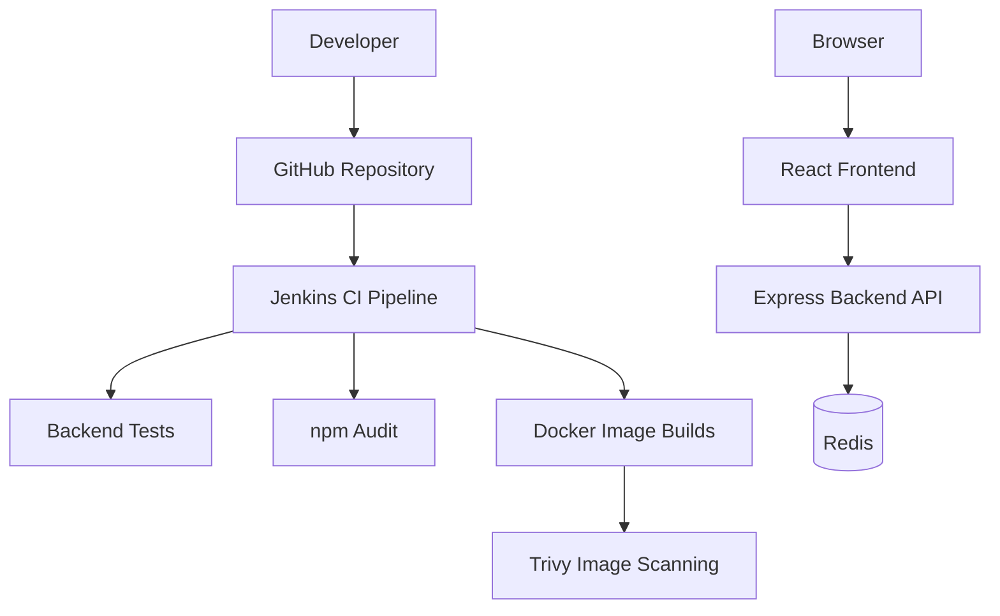
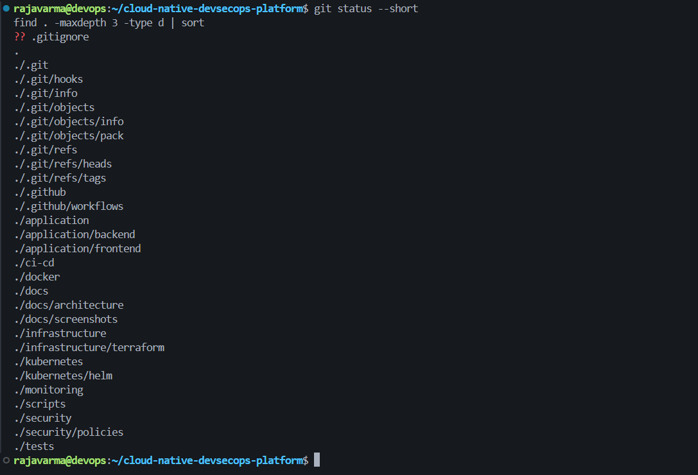
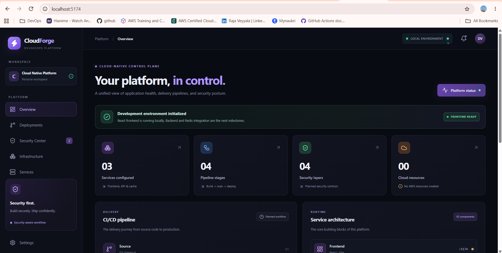
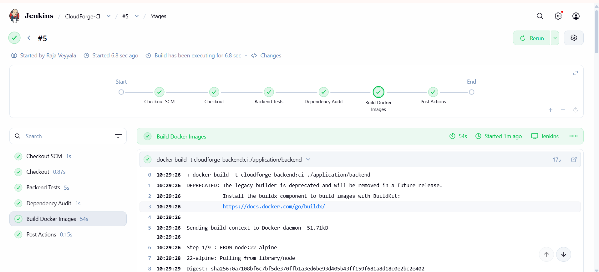
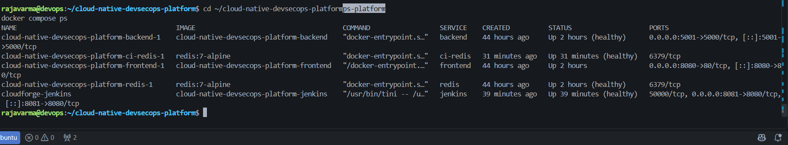
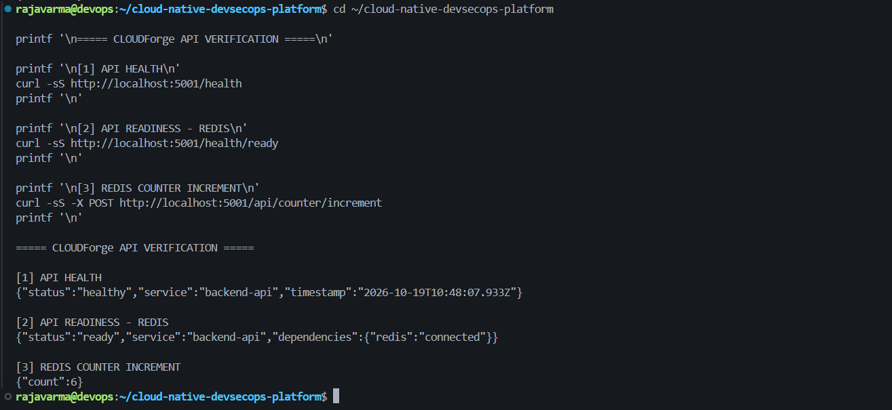
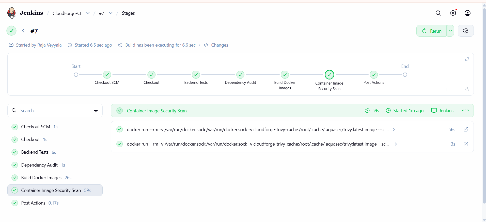
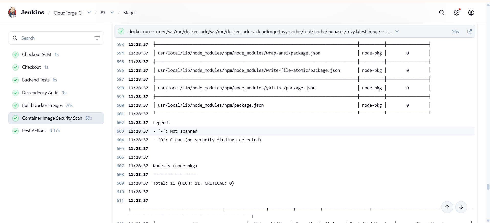
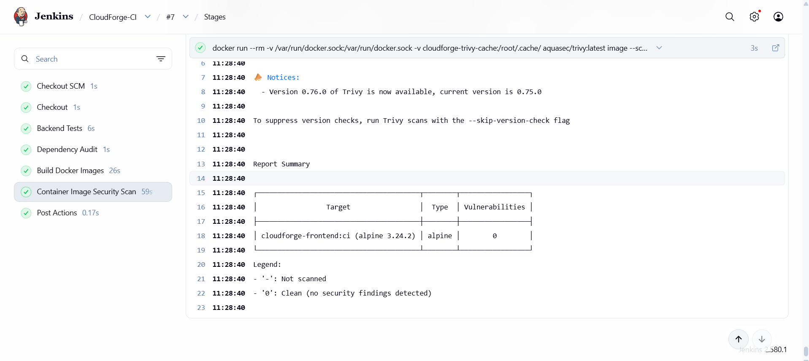

# CloudForge — Cloud-Native DevSecOps Platform

A hands-on DevOps portfolio project demonstrating containerized application development, CI automation, dependency auditing, and container image security scanning using Docker, Jenkins, GitHub, and Trivy.

**Project status:** Local application and CI pipeline implemented and verified. AWS deployment is planned as the next phase and has not yet been provisioned.

## Table of Contents

- [Overview](#overview)
- [Architecture](#architecture)
- [Technology Stack](#technology-stack)
- [Features](#features)
- [Screenshots](#screenshots)
- [Run Locally](#run-locally)
- [Application Endpoints](#application-endpoints)
- [CI Pipeline](#ci-pipeline)
- [Security Scanning](#security-scanning)
- [Repository Structure](#repository-structure)
- [Troubleshooting](#troubleshooting)
- [Roadmap](#roadmap)
- [Author](#author)

## Overview

CloudForge is a cloud-native application and DevSecOps learning project built to demonstrate how an application can be containerized, tested, audited, and security-scanned through an automated CI pipeline.

The project includes a React frontend, a Node.js/Express backend API, and Redis for application data. Docker Compose runs the local application stack, while Jenkins automates backend tests, dependency auditing, Docker image builds, and Trivy vulnerability scans.

## Architecture



This diagram describes the implemented local architecture. AWS deployment is planned but not yet implemented.

## Technology Stack

| Area | Technology |
|---|---|
| Frontend | React, Vite, Tailwind CSS |
| Backend | Node.js, Express |
| Application data | Redis |
| Containerization | Docker, Docker Compose |
| CI automation | Jenkins |
| Dependency auditing | npm audit |
| Container security | Trivy |
| Source control | Git, GitHub |
| Planned cloud platform | AWS |

## Features

- Containerized frontend and backend services.
- Redis-backed application counter.
- Backend health and readiness endpoints.
- Automated backend tests in Jenkins.
- Dependency auditing with `npm audit`.
- Docker image builds in the CI pipeline.
- Trivy scanning of backend and frontend images.
- Separate application and Jenkins Compose configurations.
- Screenshots documenting the application, containers, API checks, and security scan results.

## Screenshots

### Application and CI pipeline

| Screenshot | Description |
|---|---|
|  | Project repository structure |
|  | Frontend dashboard |
|  | Jenkins pipeline verification |
|  | Running Docker containers |
|  | Backend health verification |

### Container security scanning

| Screenshot | Description |
|---|---|
|  | Jenkins Trivy scan stage |
|  | Backend image scan summary |
|  | Frontend image scan summary |

## Run Locally

### Prerequisites

- Git
- Docker Engine
- Docker Compose plugin

### 1. Clone the repository

```bash
git clone https://github.com/rajavarma21/cloud-native-devsecops-platform.git
cd cloud-native-devsecops-platform
```

### 2. Start the application

```bash
docker compose up -d --build
docker compose ps
```

Wait for the services to start and check their health status.

### 3. Access the application

- Frontend dashboard: http://localhost:8080
- Backend health endpoint: http://localhost:5001/health
- Backend readiness endpoint: http://localhost:5001/health/ready

### 4. Verify the backend

```bash
curl -i http://localhost:5001/health
curl -i http://localhost:5001/health/ready
```

Increment the Redis-backed counter:

```bash
curl -i -X POST http://localhost:5001/api/counter/increment
```

Repeat the POST request to observe the counter value change.

### 5. Start Jenkins

The Jenkins stack uses a separate Compose file. On the Linux/WSL host, set the Docker socket group ID before starting it:

```bash
export DOCKER_GID="$(stat -c '%g' /var/run/docker.sock)"
docker compose -f docker-compose.jenkins.yml up -d --build
```

Open Jenkins at http://localhost:8081.

The configured Jenkins job is `CloudForge-CI`, using the repository's `Jenkinsfile` from the `main` branch.

**Security note:** Access to the host Docker socket gives Jenkins powerful control over the Docker host. Keep this development configuration local and do not expose it publicly without appropriate security controls.

## Application Endpoints

| Method | Endpoint | Purpose |
|---|---|---|
| GET | `/health` | Backend health check |
| GET | `/health/ready` | Readiness check, including Redis connectivity |
| POST | `/api/counter/increment` | Increment the Redis-backed counter |

The frontend is exposed locally on port `8080`, and the backend API on port `5001`.

## CI Pipeline

The Jenkins pipeline includes these stages:

1. **Checkout** — retrieves the repository source.
2. **Backend Tests** — installs locked dependencies and runs backend tests.
3. **Dependency Audit** — runs `npm audit --audit-level=high`.
4. **Build Docker Images** — builds the backend and frontend images.
5. **Container Image Security Scan** — runs Trivy against both images.

The current Trivy scan commands select HIGH and CRITICAL vulnerabilities and use `--exit-code 0`. Findings are therefore reported without making the scan itself fail the build. This is an initial reporting configuration, not an enforced security gate.

## Security Scanning

Trivy scans the built container images for known vulnerabilities. `npm audit` and Trivy complement each other: npm audit checks application package dependencies, while Trivy can also detect vulnerabilities in operating-system packages and other image contents.

### Recorded results

- **Frontend image:** zero detected HIGH and CRITICAL vulnerabilities in the recorded scan.
- **Backend image:** 11 HIGH and zero CRITICAL findings in the recorded scan.

These results apply to the recorded scan configuration and image versions. They do not guarantee that future builds will have the same findings or that no lower-severity issues exist.

The backend findings need further investigation. Review the affected packages, identify available fixes, rebuild the image, and rescan it before deciding on a blocking security policy.

A successful Jenkins build does not by itself mean that the backend image is vulnerability-free.

## Repository Structure

```text
cloud-native-devsecops-platform/
├── application/
│   ├── backend/
│   └── frontend/
├── docs/
│   └── screenshots/
├── jenkins/
├── docker-compose.yml
├── docker-compose.jenkins.yml
├── Jenkinsfile
└── README.md
```

## Troubleshooting

### Check container status

```bash
docker compose ps
docker compose logs --tail=100
```

### Inspect backend logs

```bash
docker compose logs --tail=100 backend
```

### Check API health

```bash
curl -i http://localhost:5001/health
curl -i http://localhost:5001/health/ready
```

If a service fails, inspect its logs, health status, port mappings, and environment configuration before rebuilding.

### Investigate Trivy findings

Review the affected package, installed version, fixed version, and whether the package belongs to application runtime dependencies or bundled tooling. Apply appropriate fixes and rescan rather than ignoring findings without justification.

## Roadmap

The following work is planned and should be considered incomplete until implemented and verified:

- [ ] Investigate and remediate backend image vulnerabilities where fixes are available.
- [ ] Review Trivy severity thresholds and introduce an appropriate security gate.
- [ ] Provision AWS infrastructure using Terraform.
- [ ] Publish container images to Amazon ECR.
- [ ] Deploy the application to Amazon ECS on AWS Fargate.
- [ ] Configure IAM roles, CloudWatch logging, and monitoring.
- [ ] Extend Jenkins to automate deployment to AWS.
- [ ] Document AWS costs, validation, and cleanup procedures.

## Author

**Raja Veyyala**

GitHub: [@rajavarma21](https://github.com/rajavarma21)

Project repository: [CloudForge — Cloud-Native DevSecOps Platform](https://github.com/rajavarma21/cloud-native-devsecops-platform)

