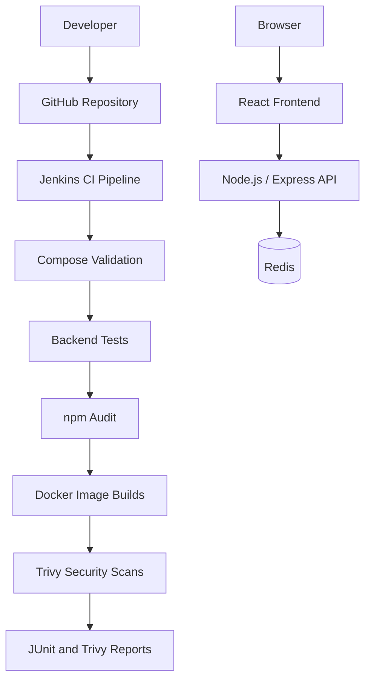
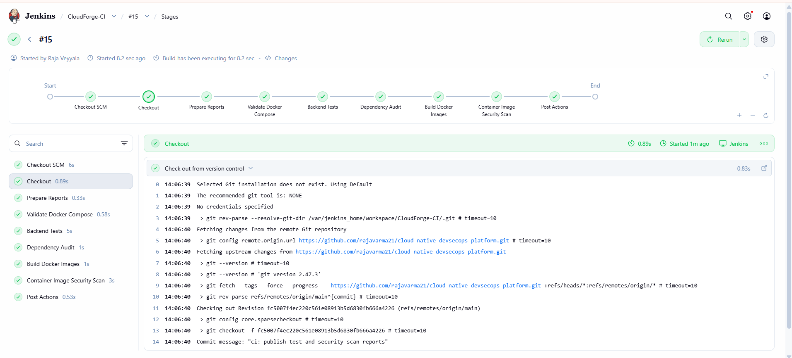
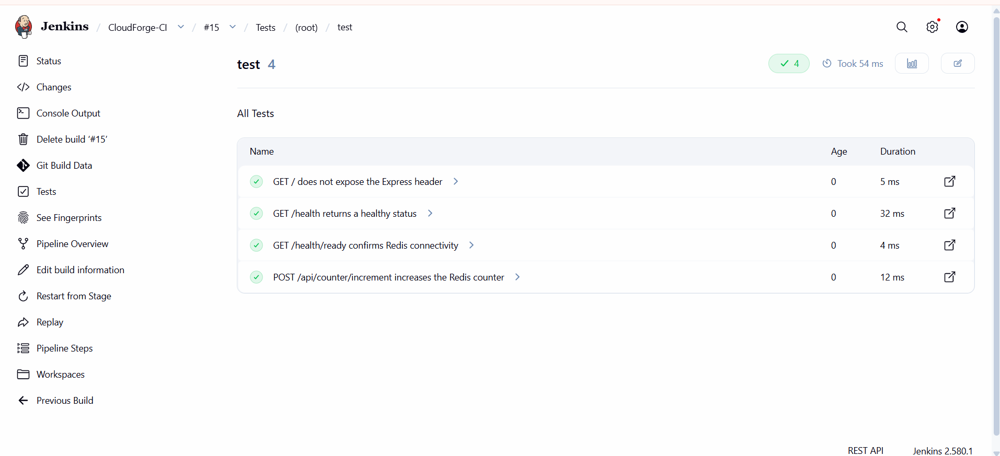
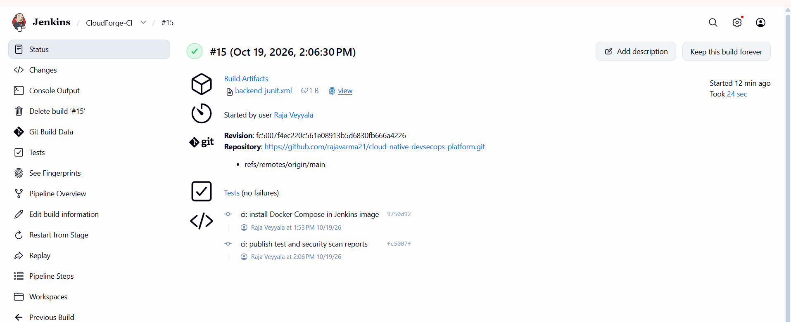

# CloudForge — Cloud-Native DevSecOps Platform

A hands-on DevOps portfolio project demonstrating containerized application development, automated CI pipelines, dependency auditing, container image vulnerability scanning, and build artifact publishing using Docker, Jenkins, GitHub, and Trivy.

**Project status:** The local application stack and Jenkins CI pipeline have been implemented and verified. AWS deployment is planned for a future phase and has not yet been provisioned.

## Table of Contents

- [Overview](#overview)
- [Architecture](#architecture)
- [Technology Stack](#technology-stack)
- [Features](#features)
- [Screenshots](#screenshots)
- [Run Locally](#run-locally)
- [Application Endpoints](#application-endpoints)
- [CI/CD Pipeline](#cicd-pipeline)
- [Security Scanning](#security-scanning)
- [Repository Structure](#repository-structure)
- [Troubleshooting](#troubleshooting)
- [Roadmap](#roadmap)
- [Author](#author)

## Overview

CloudForge is a cloud-native application and DevSecOps portfolio project designed to demonstrate how an application can be containerized, tested, audited, and security-scanned through an automated continuous integration pipeline.

The application consists of a React frontend, a Node.js/Express backend API, and Redis for application data. Docker Compose runs the local application stack, while Jenkins automates source checkout, configuration validation, backend testing, dependency auditing, Docker image builds, security scanning, and report publishing.

The repository also provides documentation and screenshots of the implemented application, CI pipeline, and security reports.

## Architecture



The diagram represents the implemented local application and CI workflow. Deployment to AWS is a planned extension, not part of the currently verified implementation.

## Technology Stack

| Area | Technology |
|---|---|
| Frontend | React, Vite, Tailwind CSS |
| Backend | Node.js, Express |
| Application data | Redis |
| Containerization | Docker, Docker Compose |
| CI/CD | Jenkins |
| Dependency auditing | npm audit |
| Container security | Trivy |
| Source control | Git, GitHub |
| Planned cloud platform | AWS |
| Planned infrastructure as code | Terraform |

## Features

- Containerized frontend and backend services.
- Redis-backed application counter.
- Backend health and readiness endpoints.
- Automated backend tests executed by Jenkins.
- Dependency auditing using `npm audit`.
- Docker Compose configuration validation in CI.
- Automated frontend and backend Docker image builds.
- Trivy vulnerability scans for both images.
- Configured HIGH and CRITICAL vulnerability gate.
- JUnit XML test report publishing.
- Archived backend and frontend Trivy JSON reports.
- Separate Compose configurations for the application and Jenkins.
- Screenshots documenting the application, pipeline, tests, and build artifacts.

## Screenshots

### Application and infrastructure

| Screenshot | Description |
|---|---|
|  | Repository structure |
|  | Frontend dashboard |
|  | Jenkins pipeline execution |
|  | Running application containers |
|  | Backend health verification |

### Container security scanning

| Screenshot | Description |
|---|---|
|  | Trivy scanning stage |
|  | Backend image scan results |
|  | Frontend image scan results |

### CI reporting and test evidence

| Screenshot | Description |
|---|---|
|  | Pipeline stages and report generation |
|  | Published backend test results |
|  | Archived JUnit and Trivy JSON reports |

## Run Locally

### Prerequisites

Install the following tools:

- Git
- Docker Engine
- Docker Compose plugin

### 1. Clone the repository

```bash
git clone https://github.com/rajavarma21/cloud-native-devsecops-platform.git
cd cloud-native-devsecops-platform
```

### 2. Start the application

```bash
docker compose up -d --build
docker compose ps
```

Check that the expected services are running and review their health status.

### 3. Access the application

- Frontend dashboard: http://localhost:8080
- Backend health endpoint: http://localhost:5001/health
- Backend readiness endpoint: http://localhost:5001/health/ready

### 4. Verify the backend API

```bash
curl -i http://localhost:5001/health
curl -i http://localhost:5001/health/ready
```

Increment the Redis-backed counter:

```bash
curl -i -X POST http://localhost:5001/api/counter/increment
```

Repeat the POST request to verify that the counter value changes.

### 5. Start Jenkins

The Jenkins stack uses a separate Compose file. On a Linux or WSL host, set the Docker socket group ID before starting Jenkins:

```bash
export DOCKER_GID="$(stat -c '%g' /var/run/docker.sock)"
docker compose -f docker-compose.jenkins.yml up -d --build
```

Open Jenkins at http://localhost:8081.

The configured pipeline job is `CloudForge-CI`, which uses the repository's `Jenkinsfile` from the `main` branch.

**Security note:** Access to the host Docker socket can provide powerful control over the Docker host. Keep this development configuration local and do not expose Jenkins publicly without appropriate security controls.

## Application Endpoints

| Method | Endpoint | Purpose |
|---|---|---|
| GET | `/health` | Backend health check |
| GET | `/health/ready` | Readiness check, including Redis connectivity |
| POST | `/api/counter/increment` | Increment the Redis-backed counter |

The frontend is exposed on port `8080`, and the backend API is exposed on port `5001` for local development.

## CI/CD Pipeline

The Jenkins pipeline automates the following stages:

1. **Checkout** — checks out the repository source.
2. **Prepare Reports** — creates the reports directory.
3. **Validate Docker Compose** — validates the Compose configuration.
4. **Backend Tests** — installs locked backend dependencies and executes the automated tests.
5. **Dependency Audit** — runs `npm audit --audit-level=high`.
6. **Build Docker Images** — builds the backend and frontend container images.
7. **Container Image Security Scan** — scans both images using Trivy.
8. **Post-build reporting** — publishes backend JUnit test results and archives files under `reports/`.

### Published build artifacts

The Jenkins job archives the following reports:

- `reports/backend-junit.xml` — backend test results in JUnit XML format.
- `reports/trivy-backend.json` — backend image vulnerability scan report.
- `reports/trivy-frontend.json` — frontend image vulnerability scan report.

These artifacts are available from the Jenkins build's **Build Artifacts** section when the files have been generated and successfully archived.

### Pipeline behavior

The current Trivy commands select HIGH and CRITICAL vulnerabilities and use `--exit-code 1`. Matching findings cause the Trivy scan command to return a non-zero exit code, allowing the security stage to fail the build.

The pipeline also uses `npm audit --audit-level=high` for backend dependency auditing. These checks have different scopes: npm audit examines Node.js dependency vulnerabilities, while Trivy scans container image contents.

A successful build indicates that the configured pipeline stages completed successfully. It does not prove the absence of every possible security issue.

## Security Scanning

Trivy scans the built backend and frontend images for known vulnerabilities. The configured severity filter targets HIGH and CRITICAL findings.

### Security controls

- Backend dependency auditing with npm audit.
- Vulnerability scanning of both container images.
- A non-zero exit code for matching HIGH and CRITICAL findings.
- JSON reports archived for later review.
- JUnit test results published for test visibility.

### Reviewing findings

When a vulnerability is reported:

1. Identify the affected package and installed version.
2. Check the reported severity and available fixed version.
3. Determine whether the package belongs to the application or the base image.
4. Apply an appropriate update where possible.
5. Rebuild the affected image.
6. Rerun the scan and review the generated report.

Security findings should be investigated and remediated based on their actual impact. Do not suppress findings without a documented reason.

Scan results apply to the specific image versions and vulnerability database used during that run. They can change as dependencies, base images, and vulnerability data change.

## Repository Structure

```text
cloud-native-devsecops-platform/
├── .github/
├── application/
│   ├── backend/
│   │   ├── src/
│   │   │   └── server.js
│   │   ├── tests/
│   │   │   └── health.test.js
│   │   ├── Dockerfile
│   │   └── package.json
│   └── frontend/
│       ├── src/
│       ├── public/
│       ├── Dockerfile
│       └── package.json
├── docs/
│   └── screenshots/
├── jenkins/
│   └── Dockerfile
├── Jenkinsfile
├── docker-compose.yml
├── docker-compose.jenkins.yml
└── README.md
```

## Troubleshooting

### Check application containers

```bash
docker compose ps
docker compose logs --tail=100
```

### Inspect backend logs

```bash
docker compose logs --tail=100 backend
```

### Check API health

```bash
curl -i http://localhost:5001/health
curl -i http://localhost:5001/health/ready
```

### Investigate a failed Jenkins build

1. Open the failed build in Jenkins.
2. Review the stage that failed.
3. Inspect the Console Output for the relevant error.
4. Check the archived test or security reports when available.
5. Correct the underlying issue and rerun the pipeline.

### Investigate Trivy findings

Review the affected package, installed version, severity, and available fix. Rebuild the image after remediation and run the scan again.

A failed Trivy stage may indicate that the configured security threshold was triggered rather than a problem with report publishing.

## Roadmap

The following items are planned and remain incomplete until implemented and verified:

- [ ] Investigate and remediate reported image vulnerabilities where fixes are available.
- [ ] Review security thresholds and document the vulnerability exception process.
- [ ] Provision AWS infrastructure using Terraform.
- [ ] Publish container images to Amazon ECR.
- [ ] Deploy the application to Amazon ECS on AWS Fargate.
- [ ] Configure IAM roles and least-privilege permissions.
- [ ] Configure CloudWatch logging and monitoring.
- [ ] Extend Jenkins to automate deployment to AWS.
- [ ] Document AWS costs, validation, and cleanup procedures.

AWS resources have not yet been provisioned for this project. The roadmap describes future work, not completed deployment functionality.

## Author

**Raja Veyyala**

GitHub: [@rajavarma21](https://github.com/rajavarma21)

Project repository: [CloudForge — Cloud-Native DevSecOps Platform](https://github.com/rajavarma21/cloud-native-devsecops-platform)

